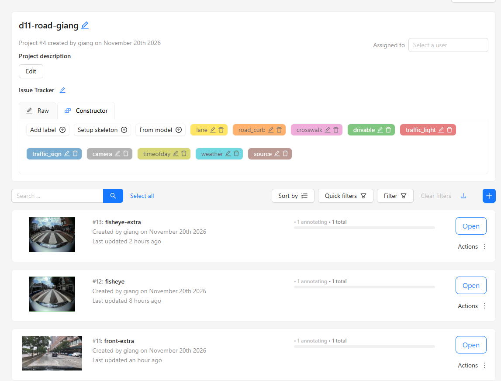
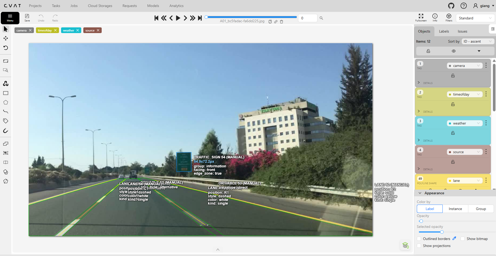
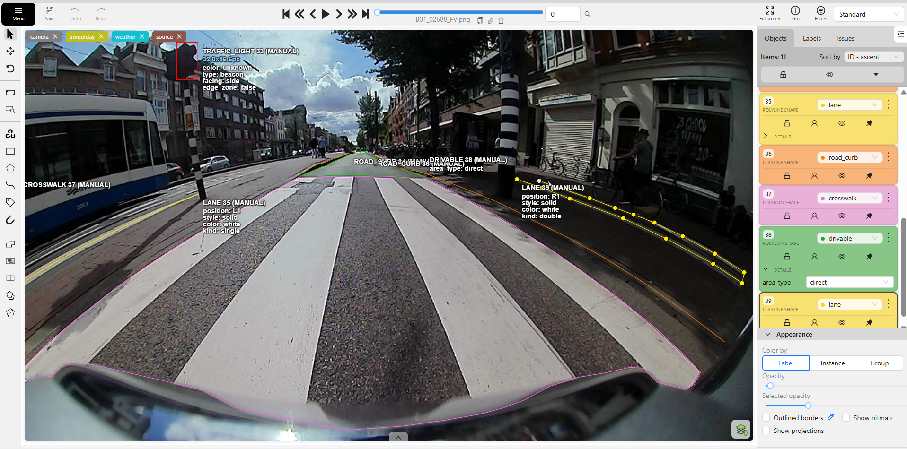

# Báo cáo cá nhân — Ngày 11
Họ tên: Nguyễn Thị Hương Giang      
Mã học viên: 2A202603233
Phiên bản CVAT (Help → About): v2.74.1
Guideline: Road v1.0    Lần nộp (`revision` trong manifest): 1
Thời điểm export (ngày giờ trên CVAT): front 20/11/2026 20:33 UTC, fisheye 20/11/2026 20:38 

## 1. Kiểm project
| Mục | Đúng như guideline Road v1.0? | Ghi chú |
| --- | --- | --- |
| 6 label, đúng kiểu | Đúng | lane/road_curb là polyline, crosswalk/drivable là polygon, traffic_light/traffic_sign là rectangle. `road_check lint` không báo lỗi QC1-12 về tên label |
| Thuộc tính và giá trị | Đúng | lane: position, style, color, kind; drivable: area_type; đèn: color, type, facing, edge_zone; biển: group, facing, edge_zone |
| 4 tag ảnh | Đúng | camera, timeofday, weather, source; mỗi tag có thuộc tính select `value` |
Cách kết thúc polyline trên bản CVAT này: | Phím N | |
Cách đặt tag ảnh trên bản CVAT này: | Mỗi tag (camera, timeofday, weather, source) là một label kiểu Tag, có một thuộc tính select tên value; ví dụ camera với value = fisheye_left. Không tạo label tag riêng cho từng giá trị. | |

## 2. Số lượng đã gán
| Task | Ảnh | lane | road_curb | crosswalk | drivable | traffic_light | traffic_sign |
| --- | ---: | ---: | ---: | ---: | ---: | ---: | ---: |
| front | 12 | 41 | 4 | 10 | 30 | 24 | 33 |
| front-extra (đã làm 4 / 4) | 4 | 17 | 2 | 6 | 11 | 7 | 16 |
| fisheye | 8 | 28 | 14 | 12 | 19 | 9 | 12 |
| fisheye-extra (đã làm 4 / 4) | 4 | 10 | 3 | 5 | 6 | 0 | 0 |

## 3. Bảng ca khó
| Ảnh | Nhãn | Phân vân giữa | Đã chọn | Lý do |
| --- | --- | --- | --- | --- |
| A05 | lane | có vạch mờ ở xa hay hoàn toàn không có vạch | Không vẽ lane (không L1, không R1) | Đã kiểm tra lại ảnh, không thấy vạch nào. Guideline dặn không vẽ thêm vạch không thấy; lint báo QC1-02 là cảnh báo gợi ý, đã nhờ coach xác nhận |
| A09 | lane (R1) | vạch bên phải có thấy được hay không | Không vẽ R1 | Đã kiểm tra lại ảnh, bên phải không có vạch nhìn thấy; chỉ vẽ L1 và L2 |
| A14 | lane (R1) | vạch bên phải có thấy được hay không | Không vẽ R1 | Đã kiểm tra lại ảnh, bên phải không có vạch nhìn thấy (ảnh ban đêm) |
| A06 | lane (R1, `other`) | nối qua chỗ che hay bỏ đoạn bị che | Nối qua chỗ che, bật `occluded` | Guideline yêu cầu một polyline liền qua chỗ bị che và bật `occluded` |
| B02 | lane (R1) | nối qua chỗ che hay tách đoạn | Nối qua chỗ che, bật `occluded` | Fisheye trước, đoạn vạch đôi bị xe che |

Lưu ý: A05, A09, A14 là ảnh mà lint báo QC1-02 nhưng thực tế không có vạch; theo `SUBMISSION.md`, cần coach xác nhận và ghi mã ảnh vào phiếu QC 1.

## 4. Phiếu QC 1 nhận được
Bạn kiểm lô của tôi: Nguyễn Tấn Dũng  Quyết định nhận được: Rework (áp dụng cho 8 ảnh bổ sung A13–A16 và B09–B12, theo phiếu ngày 21/11/2026)  
| Mã lỗi | Số lỗi | Đồng ý? | Đã sửa? |
| --- | ---: | --- | --- |
| QC1-02 (nặng): A14 thiếu lane R1 | 1 | Đồng ý. Vạch trắng bên phải A14 có thật; tôi đã gán nhầm thành `road_curb` nên lint và bạn Dũng thấy thiếu R1 | [CHỌN: Đã đổi thành lane R1 và export lại, `revision` = 2 / Chưa sửa] |

## 5. Kiểm file export
| File | Mở lại được? | Số shape ảnh 1 (job / file) | Số shape ảnh 2 (job / file) | Tag camera có trong XML? |
| --- | --- | --- | --- | --- |
| giang-front.zip | Có (annotations.xml, version 1.1) | A01: 8 / 8 | A02: 7 / 7 | Có, `front` ở cả 12 ảnh |
| giang-fisheye.zip | Có (annotations.xml, version 1.1) | B01: 7 / 7 | B02: 10 / 10 | Có, FV → fisheye_front, RV → fisheye_rear, MVL → fisheye_left, MVR → fisheye_right |

Số "job" là số shape bạn đếm trong CVAT (thanh bên phải khi mở ảnh); số "file" là số tôi đếm trong XML (không tính tag).

## 6. Ảnh chụp màn hình
## 6. Ảnh chụp màn hình

### 6.1. Tab Labels của project

### 6.2. Ảnh camera trước đã gán nhãn

### 6.3. Ảnh fisheye – Polyline cong

### 6.4. XML có polyline label lane

  <polyline label="lane" source="manual" occluded="0" points="657.88,679.20;510.67,577.96;477.38,554.32;453.00,536.40;433.80,523.40" z_order="0">
    <attribute name="position">R1</attribute>
    <attribute name="style">dashed</attribute>
    <attribute name="color">white</attribute>
    <attribute name="kind">single</attribute>
  </polyline>

## 7. Tự đánh giá [NHÁP — sửa lại theo trải nghiệm của bạn]
Lỗi bạn mắc nhiều nhất hôm nay (theo mã QC1-xx), và cách tránh ở Ngày 20:  
QC1-04 (chiều vẽ polyline: lint báo A06, A14, A16 có polyline có thể vẽ từ xa về gần) và QC1-01 ở ảnh thêm B09 (thiếu cả bốn tag). Cảnh báo QC1-02 ở A05, A09, A14 là do ảnh thật sự không có vạch, không phải lỗi bỏ sót. Ngày 20 tôi sẽ đặt tag ngay khi mở ảnh, trước khi vẽ gì khác, và chạy `road_check lint` sau mỗi 3–4 ảnh để bắt lỗi sớm thay vì đợi export cuối.

Nhãn của bạn đi vào model ở đâu? Chọn một lỗi đã sửa và nói nó làm model học sai thế nào:  
Nhãn lane đi vào đích row-anchor: với mỗi hàng y cố định, model học x của vạch. Nếu thiếu R1 thì mọi hàng của vạch phải bị học là "không có làn", model sẽ học bỏ qua vạch phải thật sự tồn tại và hệ thống giữ làn (LKA) mất một mốc căn chỉnh. Nếu polyline vẽ ngược chiều (từ xa về gần), script nội suy theo điểm đầu gần xe sẽ lấy sai đoạn, nhãn lệch và model học vị trí sai.
